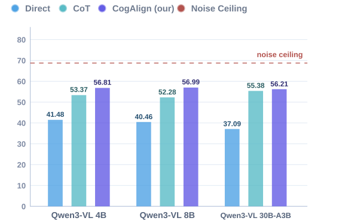
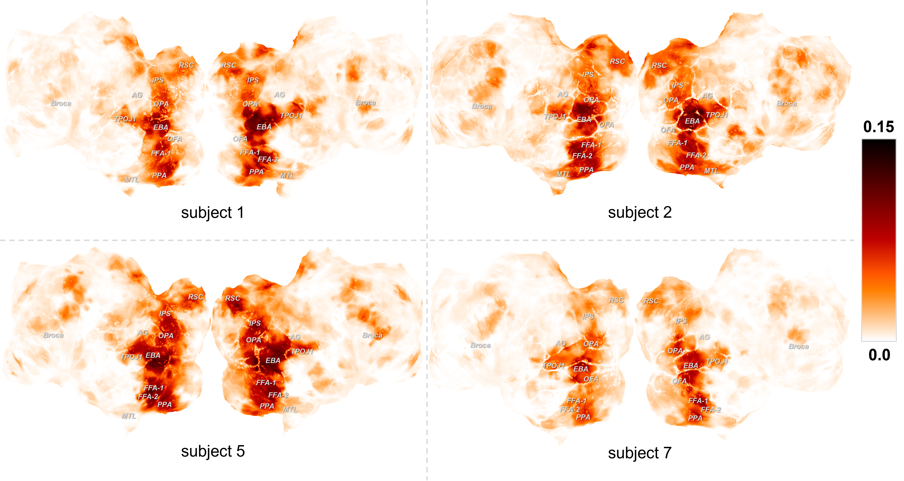
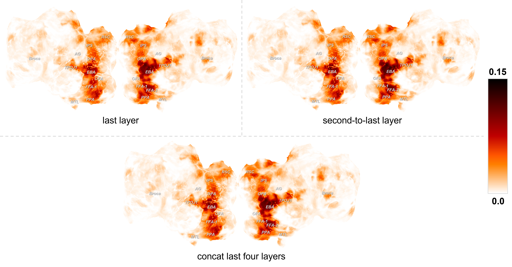

# CogAlign: Aligning MLLMs with the Latent Structure of Human Cognition via Behavior-Derived Semantic Dimensions**

Ning E, Changde Du, Yizhuo Lu, and Huiguang He  
NeurIPS 2026 · Poster

[[`Paper`](https://arxiv.org/abs/2610.41951v1)] [[`Poster`](docs/assets/cogalign-neurips-2026-poster.png)] [[`BibTex`](#Citation)]

People compare objects by focusing on meaningful qualities they share, such as what they are made of, how they look, or what they are used for. We ask whether teaching AI to use these underlying cognitive dimensions can make its decisions more consistent with human thinking. Building on 4.70 million human choices, we identify the dimension that best explains each choice and translate it into linguistic rationale. Our method, CogAlign, then trains AI using these rationales alongside the human choices. The trained AI shows better agreement with human similarity judgments while retaining competitive general performance. An independent analysis of fMRI data collected while people view natural objects further reveals closer alignment between the AI internal representations and patterns of human brain activity. Our findings offer a data-driven approach to incorporating human cognitive structure into AI, helping researchers better understand and guide AI decisions.

## Results
### General Performance
CogAlign consistently improves MMMU<sub>val</sub> by 3.12 - 4.34, while yielding declines of 0.05 - 3.58 on MMBench<sub>en, test</sub>, suggesting benchmark-dependent trade-off in general multimodal capabilities rather than uniform capability degradation.

<table>
  <tr>
    <th colspan="1">Benchmark</th>
    <th colspan="1">Model</th>
    <th colspan="1">Scale</th>
    <th colspan="1">Baseline</th>
    <th colspan="1">CogAlign</th>
  </tr>
  <tr>
    <td rowspan="2">MMMU<sub>val</sub></td>
    <td rowspan="2">Qwen3-VL</td>
    <td>4B</td>
    <td>48.44</td>
    <td>51.56</td>
  </tr>
  <tr>
    <td>8B</td>
    <td>50.67</td>
    <td>54.22</td>
  </tr>
  <tr>
    <td rowspan="2">MMBench<sub>en,test</sub></td>
    <td rowspan="2">Qwen3-VL</td>
    <td>4B</td>
    <td>82.96</td>
    <td>81.39</td>
  </tr>
  <tr>
    <td>8B</td>
    <td>83.91</td>
    <td>83.86</td>
  </tr>
  
</table>

### Human Consistency
On 453,642 held-out THINGS triplets, CogAlign improves human consistency over both Direct and CoT baselines across Qwen3-VL model scales (4B to 30B-A3B), maintaining stable accuracy range of 56.21 - 56.99. Centaur 70B scores 51.96. The human noise ceiling is 68.74. CogAlign robustness ranges 56 ~ 57.



### Neuroscientific Analysis
Searchlight RSA comparing MLLMs internal representation with human brain, revealing improved geometry alignment across four subjects on the independent NSD fMRI dataset. Darker colors indicate better CogAlign alignment with human brain over Baseline.

<div style="display: flex; justify-content: center; gap: 20px; text-align: center;">
  
  <div style="flex: 1; max-width: 45%;">
    
    <p><i>Subj 1, 2, 5, 7 · last layer</i></p>
  </div>

  <div style="flex: 1; max-width: 45%;">
    
    <p><i>Subj 1 · last layer, second-to-last layer, concat last four layers</i></p>
  </div>

</div>

## Models
See our HuggingFace [collection](https://huggingface.co/collections/ening-open/cogalign) for released CogAlign models.

## Dataset
See our HuggingFace [dataset](https://huggingface.co/datasets/ening-open/cogalign) for released cogalign datasets.

## Getting Started
### Setup

```
conda create -n cogalign python=3.12 -y
conda activate cogalign
pip install -r requirements.txt
pip install -e . # for development mode
```

### Usage Demo
#### Train
```
bash scripts/sft_qwen3vl_4b_it_align.sh /path/to/model /path/to/images /path/to/train.json /path/to/validation.json path/to/output
```

#### Inference
```bash
IMAGE_DIR=/path/to/things-images
DATA_PATH=/path/to/o1o-heldout-data.json
BASE_MODEL=/path/to/model
ALIGNED_MODEL=/path/to/model-cogalign

for condition in baseline aligned; do
  model="$BASE_MODEL"
  if [ "$condition" = aligned ]; then model="$ALIGNED_MODEL"; fi
  bash scripts/infer_qwenvl.sh infer "runs/o1o-$condition" \
    "$DATA_PATH" "$IMAGE_DIR" "$model" "qwenvl_$condition" \
    --temperature 0 --top-p 1 --top-k -1 \
    --repetition-penalty 1.05 --max-new-tokens 8192 \
    --presence-penalty "${PRESENCE_PENALTY:?set from the archived run}" \
    --tensor-parallel-size "${TENSOR_PARALLEL_SIZE:?set from the archived run}" \
    --max-model-len "${MAX_MODEL_LEN:?set from the archived run}" \
    --min-pixels "${MIN_PIXELS:?set from the archived run}" \
    --max-pixels "${MAX_PIXELS:?set from the archived run}"
done
```

## Citation

If you find this work useful in your research, please consider giving a star and cite the paper:

```bibtex
@misc{e2026aligningmllmslatentstructure,
  title={Aligning MLLMs with the Latent Structure of Human Cognition via Behavior-Derived Semantic Dimensions}, 
  author={Ning E and Changde Du and Yizhuo Lu and Huiguang He},
  year={2026},
  eprint={2610.41951},
  archivePrefix={arXiv},
  primaryClass={cs.CL},
  url={https://arxiv.org/abs/2610.41951}, 
}
```
