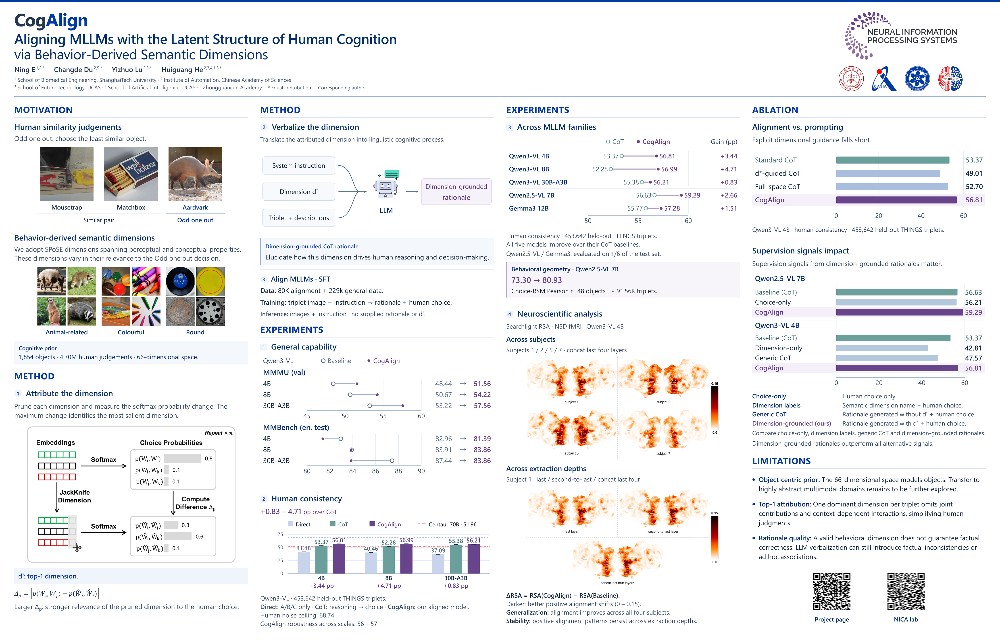

# CogAlign

**Aligning MLLMs with the Latent Structure of Human Cognition via Behavior-Derived Semantic Dimensions**

Ning E, Changde Du, Yizhuo Lu, and Huiguang He  
NeurIPS 2026 · Poster

[Paper (arXiv v1)](https://arxiv.org/abs/2610.41951v1) · [NeurIPS poster listing](https://neurips.cc/virtual/2026/poster/152778) · [Reproduction guide](docs/reproduction.md) · [Data and checkpoints](docs/data.md) · [Shell examples](scripts/README.md)

[](docs/assets/cogalign-neurips-2026-poster.png)

CogAlign uses a 66-dimensional SPoSE representation of 1,854 objects derived from 4.70 million human odd-one-out judgments. For each triplet, it removes one semantic dimension at a time and measures the change in probability assigned to the human-selected pair. A language model verbalizes the highest-scoring dimension as a rationale. Supervised fine-tuning learns to generate the rationale and the human choice while mixing in general multimodal instruction data. At evaluation, the aligned model receives the images and task instruction. [Paper, §3](https://arxiv.org/html/2610.41951v1)

## Paper results

| Qwen3-VL | THINGS O1O (CoT → CogAlign) | MMMU validation (baseline → CogAlign) | MMBench English test (baseline → CogAlign) |
| --- | ---: | ---: | ---: |
| 4B | 53.37 → **56.81** (+3.44 pp) | 48.44 → **51.56** | **82.96** → 81.39 |
| 8B | 52.28 → **56.99** (+4.71 pp) | 50.67 → **54.22** | **83.91** → 83.86 |
| 30B-A3B | 55.38 → **56.21** (+0.83 pp) | 53.22 → **57.56** | **87.44** → 83.86 |

All scores are percentages. The O1O evaluation uses 453,642 held-out triplets. In a separate 48-object analysis, the reported human–model geometry score rises from 73.30% to 80.93% for Qwen2.5-VL-7B. The paper also reports positive fMRI searchlight RSA shifts for Qwen3-VL-4B across four NSD participants. [Paper, Tables 1–2 and Figures 4–6](https://arxiv.org/html/2610.41951v1#S4)

## Quick start

Install in a Python 3.10+ environment from the repository root.

```bash
python -m pip install -e .
```

Run a CPU-only evaluation on two synthetic records. It requires no model weights, images, or API key.

```bash
python - <<'PY'
from cogalign.evaluation.odd_one_out import build_correctness, summarize_accuracy

records = [
    {"id": 0, "option": ["A", "B", "C"], "label_choice": "B", "response": "Answer: B"},
    {"id": 1, "option": ["A", "B", "C"], "label_choice": "A", "response": "Answer: C"},
]
print(summarize_accuracy(build_correctness(records)))
PY
```

Expected accuracy is `0.5` (one correct prediction out of two).

| Workflow | Install extra | Entry point |
| --- | --- | --- |
| Qwen3-VL supervised fine-tuning | `.[train]` | [`scripts/sft_qwen3vl_4b_it_align.sh`](scripts/sft_qwen3vl_4b_it_align.sh) |
| Paper-style O1O inference with vLLM | `.[vllm]` | [`scripts/infer_qwenvl.sh`](scripts/infer_qwenvl.sh) with `infer` |
| Transformers inference | `.[inference]` and `accelerate` | Same script with `hf_infer` |
| Extraction and fMRI searchlight | `.[neural]` and `accelerate` | `cogalign.neural.extract_hidden_states`, `cogalign.neural.searchlight_rsa` |
| Cortical visualization | `.[visualization]` | `cogalign.neural.plot_searchlight` |
| Rationale judge and embedding analysis | `.[judge]` or `.[rationale]` | `cogalign.evaluation.kimi_judge`, `cogalign.evaluation.rationale_metrics` |

For example, install `python -m pip install -e '.[vllm]'` for vLLM inference. Use Bash on a compatible Linux CUDA environment for the train and GPU inference examples. SFT, Transformers inference, and hidden-state extraction also require a compatible FlashAttention 2 build. Install `.[train,tracking]` for SwanLab or `.[train,quantization]` for four-bit fine-tuning. The 48-object RSM-to-RDM and scoring steps use GNU Octave. [Qwen3-VL setup](https://github.com/QwenLM/Qwen3-VL)

## Reproduce the paper

Start with the [result-by-result reproduction guide](docs/reproduction.md). It maps Tables 1–4, the appendix analyses, and Figures 4–6 to repository commands and intermediate files. The checkout supports SFT from prepared JSON, Qwen-VL inference, O1O scoring, and behavioral RSA from encoded triplets. Paper-number reproduction also needs the experiment-specific [data, weights, and run records](docs/data.md), including the missing conversion from raw NSD hidden states to searchlight inputs.

## Citation

Use [CITATION.cff](CITATION.cff) or the following BibTeX.

```bibtex
@misc{e2026aligningmllmslatentstructure,
  title={Aligning MLLMs with the Latent Structure of Human Cognition via Behavior-Derived Semantic Dimensions}, 
  author={Ning E and Changde Du and Yizhuo Lu and Huiguang He},
  year={2026},
  eprint={2610.41951},
  archivePrefix={arXiv},
  primaryClass={cs.CL},
  url={https://arxiv.org/abs/2610.41951}, 
}
```
